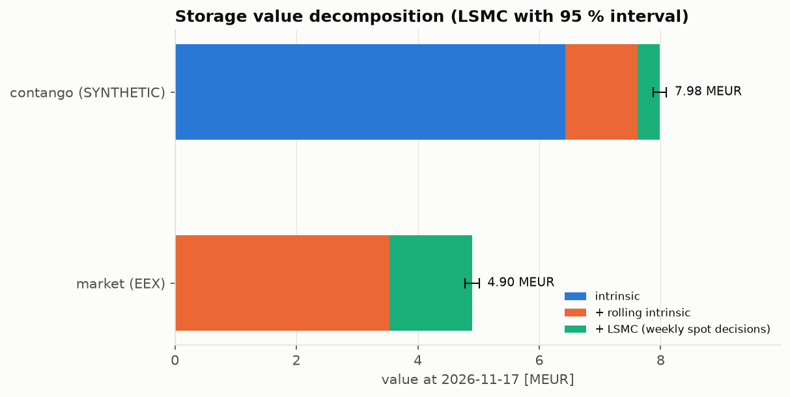
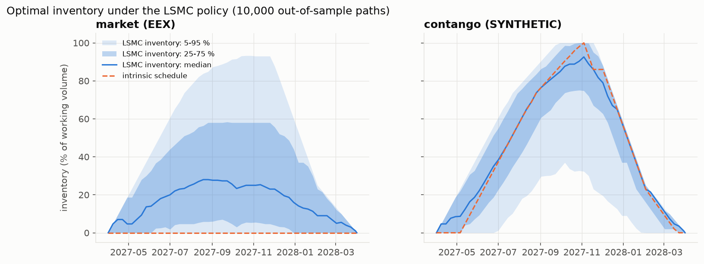
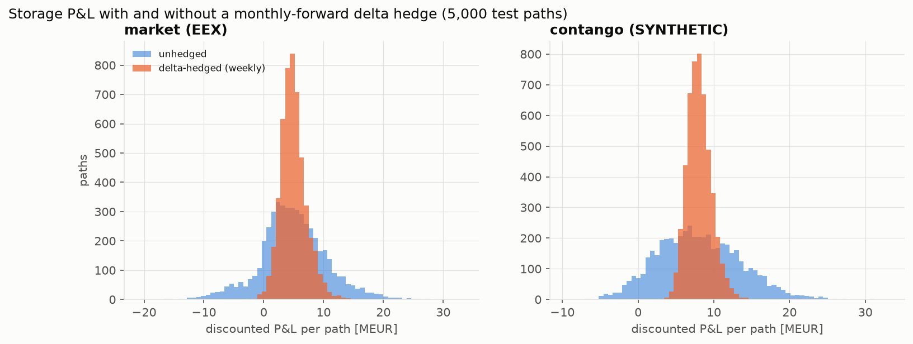

# TTF Gas Storage Valuation

Valuing a natural gas storage contract on the Dutch TTF hub as a real option: intrinsic value by linear and
mixed-integer programming on the forward curve, extrinsic value by Least-Squares Monte Carlo, greeks, and a
monthly-forward delta hedge.

## Key results

A 1 TWh storage (150 days to fill, 100 days to empty, ratchets) over storage year **2027/28**, valued on
**2026-11-17** against the **EEX TTF futures settlement curve** of that day. A second, **synthetic** contango curve
uses the same contract and model to show what the market case cannot (see *Two curves* below).

| | Market case (EEX 2026-11-17) | Contango case (SYNTHETIC) |
|---|---:|---:|
| Intrinsic value (forward curve, weekly MILP) | **0.00 MEUR** | 6.54 MEUR |
| Rolling intrinsic (monthly re-optimisation) | 3.53 ± 0.12 MEUR | 7.62 ± 0.13 MEUR |
| **LSMC value** (out-of-sample lower bound) | **4.90 ± 0.06 MEUR** | **7.98 ± 0.06 MEUR** |
| Extrinsic value (LSMC − intrinsic, same grid) | **4.90 MEUR (100 %)** | 1.55 MEUR (19 %) |
| Unhedged P&L standard deviation | 5.69 MEUR | 5.56 MEUR |
| Delta-hedged P&L standard deviation (weekly) | **2.14 MEUR (−62 %)** | 1.59 MEUR (−71 %) |
| Vega (+0.01 σ) / sensitivity to κ (+1 per year) | +120 kEUR / +239 kEUR | +45 kEUR / +41 kEUR |

± is one Monte Carlo standard error (fixed seeds). LSMC uses weekly decisions, 101 volume levels and 10,000 regression
plus 10,000 independent valuation paths (about 25 s on a laptop). Hedge statistics use 5,000 fit and 5,000 test paths.

**The headline.** On the real curve the storage has *zero* intrinsic value, yet it is worth about **4.9 MEUR**
(4.9 EUR per MWh of capacity), all of it optionality. Storage year 2027/28 trades in seasonal backwardation (every
month from April 2027 to March 2028 is cheaper than the one before, from 71.2 to 54.3 EUR/MWh), consistent with the
low European storage fill of 2026 shown by GIE AGSI+ data. No calendar spread can be locked in today; the value comes
from reacting to price moves.





On the market curve the optimal policy does not run a seasonal cycle: the median inventory stays below 30 % and the
storage is filled opportunistically when the spot dips below the curve and emptied into price spikes. On the contango
curve the policy follows the intrinsic fill-and-empty profile and trades around it.



A weekly-rebalanced hedge with monthly forwards removes about 60-70 % of the P&L standard deviation without changing
its mean. The remaining risk is mostly the spot exposure inside each delivery month, which monthly forwards cannot
hedge.

## Two curves, on purpose

| | Market case `configs/storage_default.yaml` | Contango case `configs/storage_synthetic.yaml` |
|---|---|---|
| Forward curve | EEX TTF settlements, 2026-11-17 | **SYNTHETIC**: level + winter premium + contango |
| Shape over 2027/28 | strictly decreasing (backwardation) | summer trough, winter peak |
| What it shows | the value a desk would book today: pure optionality | the textbook storage trade: LP = DP cross-check, intrinsic / extrinsic split, rolling intrinsic vs LSMC |

The market case is the real answer, but a zero intrinsic schedule hides most of the machinery. The contango case keeps
the same contract and model on an illustrative curve where every component is visible. Its level (about 30 EUR/MWh)
is half the market level, so compare the *structure* of the two cases, not their amounts.

## Methodology

**Price model** (Schwartz, 1997; Lucia & Schwartz, 2002), fitted exactly to the forward curve:

$$\ln S_t = \ln F(0,t) + X_t - \tfrac12 V(0,t),\qquad dX_t = -\kappa X_t\,dt + \sigma\,dW_t,\qquad
V(t,T) = \tfrac{\sigma^2}{2\kappa}\big(1-e^{-2\kappa(T-t)}\big),$$

so $\mathbb E[S_t] = F(0,t)$, with implied forwards
$F(t,T) = F(0,T)\exp\big(e^{-\kappa(T-t)}X_t + \tfrac12 V(t,T) - \tfrac12 V(0,T)\big)$ (derived and checked for the
martingale property in notebook 02). $X$ is simulated exactly. $\kappa = 4.78 \pm 1.59$ per year (half-life 53 days)
and $\sigma = 0.694 \pm 0.016$ are exact-MLE estimates on deseasonalised TTF front-month prices, April 2023 to
November 2026.

**Storage problem.** Inventory $v_{k+1} = v_k + i_k - w_k$, $0 \le v_k \le \bar V$, rate limits with fill-dependent
ratchets, $v_0 = v_K = 0$, and discounted cash flows
$\pi = D_k\big[(P_k - c^{w})w_k - (P_k(1+\lambda) + c^{i})i_k\big]$.

* **Intrinsic**: maximise $\sum_k \pi_k$ at $P_k = F(0,t_k)$. LP with nominal rates; ratchets made exact by a MILP
  with binary tier variables (cvxpy + HiGHS); cross-checked by a dynamic programme on a volume grid.
* **Rolling intrinsic**: the intrinsic problem re-solved every month along simulated forward curves.
* **LSMC** (Longstaff & Schwartz, 2001; Boogert & de Jong, 2008): backward induction on a 101-level volume grid with
  one regression of the continuation value per level,
  $\hat C_k(v', x) = \phi(x)^\top\hat\beta_k(v')$ (cubic polynomials of the standardised state), then the resulting
  policy is applied to **independent** paths. The estimate is an unbiased value of a feasible policy, hence a
  **lower bound** of the true value.

**Risk.** Greeks by bump-and-revalue of the full LSMC with common random numbers (delta per delivery month, gamma,
vega, sensitivity to κ). The hedge ratio per forward month comes from the envelope theorem,
$\Delta_m(\tau) = \mathbb E_\tau\big[\sum_{k\in m} D_k(w_k-(1+\lambda)i_k)S_{t_k}\big]/F_m(\tau)$, estimated by
regression on the state and inventory, with bid-ask transaction costs.

**Validation (tests, `pytest`).** LP = DP without ratchets; DP converges to the MILP as the grid is refined; zero
intrinsic value on a flat curve with costs and on the backwardated market curve; LSMC → intrinsic as σ → 0;
LSMC ≥ intrinsic − 3 SE; value increasing in σ; convergence in paths, grid and basis; in-sample and out-of-sample
LSMC estimates consistent (catches look-ahead bugs); martingale properties of $S_t$ and $F(t,T)$ within 3 SE;
calibration recovers known parameters; greeks stable across seeds with CRN.

## Limitations

* **Illustrative contract.** Volumes, rates, ratchets and costs do not describe any real storage site.
* **Historical vs risk-neutral parameters.** σ is measure-invariant, but κ is only if the market price of risk is
  constant, which commodity data does not support. κ is also weakly identified (Dickey-Fuller statistic −3.0) and
  depends on the calibration window: with the same seeds the market-case value ranges from 1.2 MEUR (full-sample
  calibration) to 11.0 MEUR (crisis volatility). **Parameter risk is much larger than Monte Carlo error.**
  Option-implied volatility and a term structure of forward volatilities would pin down σ and κ under the pricing
  measure.
* **LSMC is a lower bound,** and the volume grid adds a downward bias of about 2 % at 101 levels (convergence study
  in notebook 04). A dual upper bound (Andersen-Broadie) would bracket the true value.
* **One factor.** All forwards are driven by one mean-reverting factor, so long-dated forwards barely move and the
  curve cannot change shape independently of the spot. A two-factor Schwartz-Smith model is the natural extension.
* **Forward data.** One trading day of EEX settlements typed by hand; the hedge uses model-implied monthly forwards
  without a delivery-month spot hedge.
* **Weekly decisions** apply ratchets at the start of each week; daily runs give the same LSMC value within error.

## Related work

The hedge here is a classical delta hedge with a fixed rebalancing rule. My companion repository
[`deep-hedging-transaction-costs`](https://github.com/Baptiste251001/deep-hedging-transaction-costs) learns the hedging strategy directly under transaction costs, which is the natural
way to address the cost / variance trade-off measured in notebook 05.

## Reproduce

```bash
python -m pip install -e ".[dev,data]"                     # Python 3.11
python scripts/run_valuation.py --config configs/storage_default.yaml
python scripts/run_valuation.py --config configs/storage_synthetic.yaml --paths 2000 --greeks --hedge monthly --json out.json
pytest -m "not slow"
```

`configs/storage_default.yaml` needs the EEX settlement table in `data/raw/` (not redistributed; see
[data/README.md](data/README.md) for sources and how to obtain them). `configs/storage_synthetic.yaml` runs without
any data. Notebooks `01` to `05` reproduce every number and figure; `04` and `05` take 10-25 minutes.

## Repository structure

```
configs/          storage_default.yaml (EEX curve), storage_synthetic.yaml (synthetic curve)
data/             README with sources and licences; raw/ and processed/ are gitignored
src/gasstorage/
  config.py       validated configuration dataclasses
  data/           TTF history (yfinance), GIE AGSI+ client, forward curve (EEX table, CSV, synthetic)
  models/         seasonality, one-factor OU model, calibration (OLS / MLE, standard errors)
  storage/        contract, intrinsic LP / MILP, grid DP, rolling intrinsic, regression basis, LSMC
  risk/           greeks (bump-and-revalue, CRN), delta hedge
  cli.py          command-line valuation
notebooks/        01 data, 02 price model, 03 intrinsic, 04 LSMC, 05 greeks and hedging
reports/figures/  figures used in this README
tests/            pytest suite
```

## Data sources

TTF front-month history: Yahoo Finance (`TTF=F`). Forward curve: EEX TTF Natural Gas Futures settlement prices of
2026-11-17. Storage levels: GIE AGSI+ (Source: GIE AGSI+). Details and terms in [data/README.md](data/README.md).

## References

* Boogert, A. and de Jong, C. (2008). Gas storage valuation using a Monte Carlo method. *Journal of Derivatives*,
  15(3), 81-98.
* Longstaff, F. A. and Schwartz, E. S. (2001). Valuing American options by simulation: a simple least-squares
  approach. *Review of Financial Studies*, 14(1), 113-147.
* Schwartz, E. S. (1997). The stochastic behavior of commodity prices: implications for valuation and hedging.
  *Journal of Finance*, 52(3), 923-973.
* Schwartz, E. S. and Smith, J. E. (2000). Short-term variations and long-term dynamics in commodity prices.
  *Management Science*, 46(7), 893-911.
* Lucia, J. J. and Schwartz, E. S. (2002). Electricity prices and power derivatives: evidence from the Nordic Power
  Exchange. *Review of Derivatives Research*, 5(1), 5-50.

## License

MIT
